<div align="center">

# StegoLab

### AI-Enhanced Secure Steganography & Steganalysis

**Hide** encrypted data inside images · **Detect** hidden data with trained neural networks · **Explain** every verdict · **Attack** payloads with real-world processing · **Report** the evidence


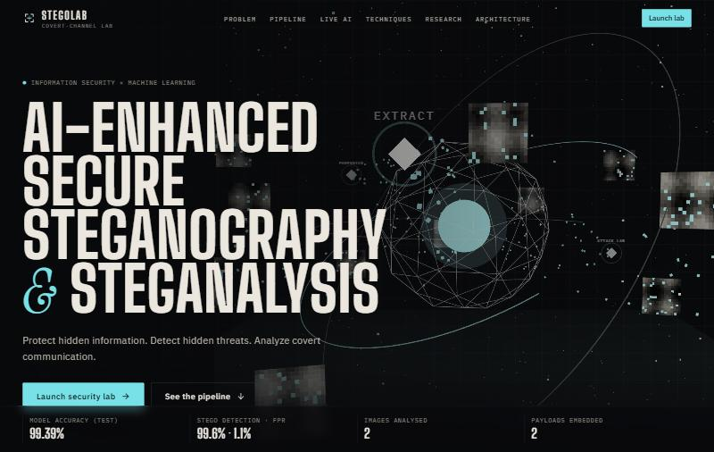

</div>

---

StegoLab is a full-stack information-security and machine-learning platform. It encrypts a secret
with **AES-256-GCM**, hides it in an image with **LSB, DCT or DWT** steganography, and then turns
the problem around: a **trained CNN + Random Forest + anomaly detector** looks for hidden data in
any image, shows *where* and *why* with Grad-CAM, and scores the risk.

**Every number on screen is measured.** Metrics come from real cryptography, real image
processing, real model inference on held-out data, or a real database query. Nothing in the
interface is hard-coded or simulated.

## Contents

- [Features](#features)
- [Screenshots](#screenshots)
- [Measured results](#measured-results)
- [Quick start](#quick-start)
- [Using StegoLab](#using-stegolab)
- [How it works](#how-it-works)
- [Architecture](#architecture)
- [Reproducing the research](#reproducing-the-research)
- [Testing](#testing)
- [Configuration](#configuration)
- [Troubleshooting](#troubleshooting)
- [Limitations](#limitations)
- [Documentation](#documentation)
- [Credits](#credits)

## Features

| Area | What is implemented |
|---|---|
| **Cryptography** | AES-256-GCM with an authenticated header; keys from **Argon2id** (64 MiB, t=3, p=4) or a random 256-bit key; SHA-256 integrity at two layers |
| **Steganography** | **LSB** (RGB, 3 bits/pixel), **DCT** quantisation-index modulation in 8×8 JPEG-style blocks, **DWT** 3-level Haar QIM. Framed bitstream with **Reed-Solomon** error correction; the method is auto-detected on extraction |
| **Image quality** | MSE, PSNR and SSIM (checked against scikit-image to 1e-6), before/after slider with zoom and amplified difference maps |
| **AI detection** | **StegoNet**: a multi-domain CNN (spatial SRM residuals + weighted-stego parity, DCT histograms, wavelet histograms). Also a **Random Forest** on 99 handcrafted features and a Mahalanobis **anomaly** model. Runs on CUDA or CPU |
| **Explainability** | Grad-CAM heat maps for each CNN branch, evidence share per domain, a per-tile probability map and the top handcrafted signals |
| **Risk scoring** | A 0–100 score from CNN, RF and anomaly evidence, raised to a floor when a valid StegoLab frame is found |
| **Forensics** | LSB-plane and noise-residual views, per-channel LSB statistics and entropy, χ² / sample-pair analysis, DCT and wavelet statistics, EXIF metadata, file hashes, plain-language findings |
| **Attack lab** | JPEG, Gaussian noise, salt-and-pepper, blur, median, resize, crop, brightness, contrast and rotation. Each attack re-measures extraction, integrity, BER, PSNR/SSIM and detection |
| **Research** | LSB vs DCT vs DWT on held-out images: capacity, quality, robustness, detectability and speed, with a transparent balance score |
| **Reports** | PDF security reports with images, metrics, model version and SHA-256 hashes |
| **Security** | Argon2id passwords, short-lived JWTs, rotating refresh cookies with reuse detection, server-side RBAC, account lockout, rate limiting, CSRF header check, CSP, audit log, data retention |
| **Interface** | React 19 + TypeScript, a Three.js hero, scroll storytelling driven by a live server-side demo, live operation logs, responsive and reduced-motion aware |

## Screenshots

<table>
  <tr>
    <td width="50%">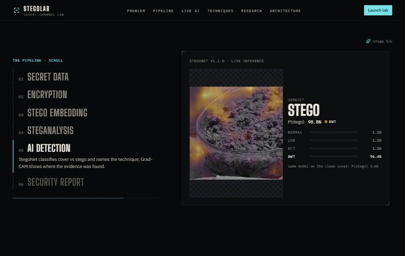<br><sub><b>Scroll story</b>: the pipeline explained with live results</sub></td>
    <td width="50%">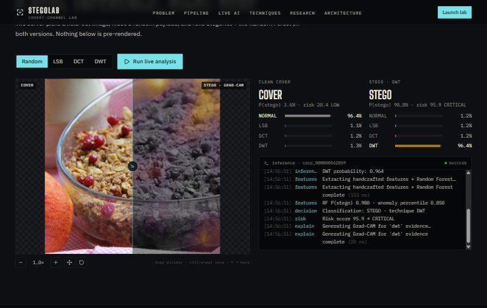<br><sub><b>Live demo</b>: real StegoNet inference on the landing page</sub></td>
  </tr>
  <tr>
    <td>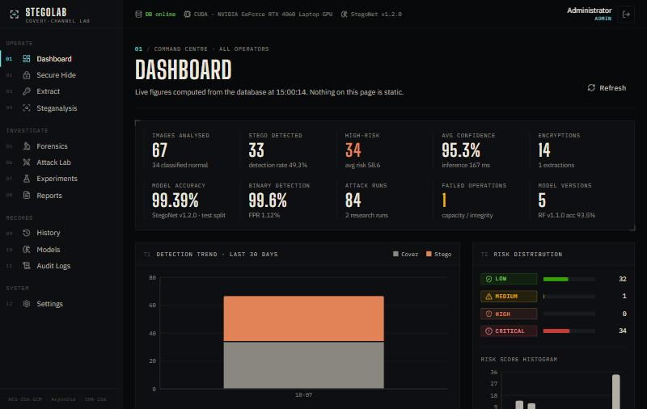<br><sub><b>Dashboard</b>: activity, detections and risk from the database</sub></td>
    <td>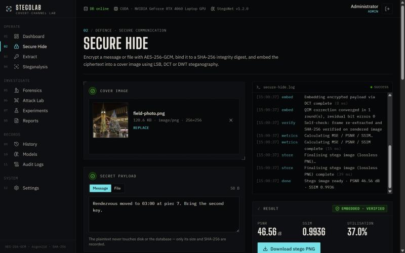<br><sub><b>Secure Hide</b>: encrypt and embed with a live operation log</sub></td>
  </tr>
  <tr>
    <td>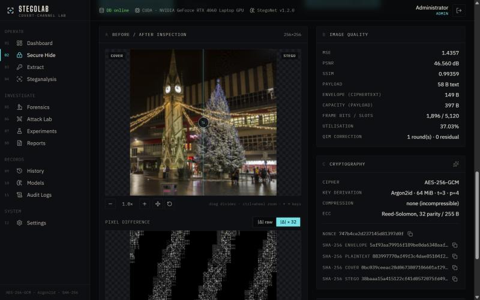<br><sub><b>Before / after</b>: PSNR, SSIM, MSE and difference map</sub></td>
    <td>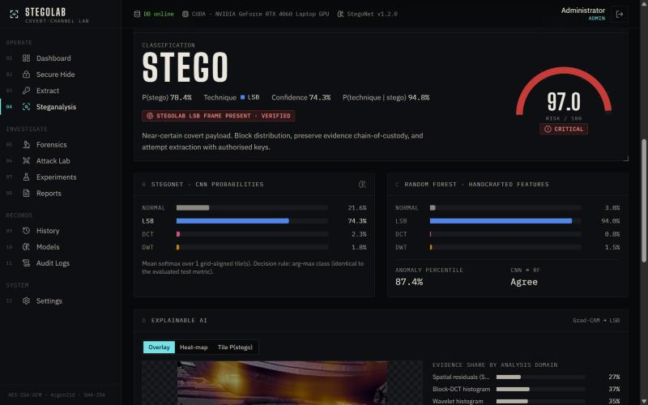<br><sub><b>Steganalysis</b>: verdict, technique and risk score</sub></td>
  </tr>
  <tr>
    <td>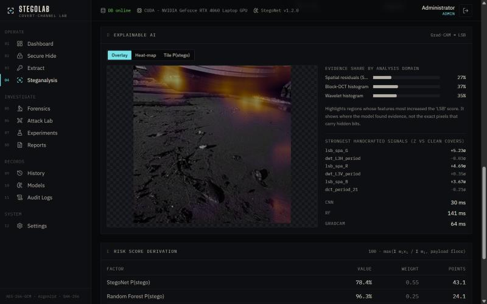<br><sub><b>Explainable AI</b>: Grad-CAM and evidence by domain</sub></td>
    <td>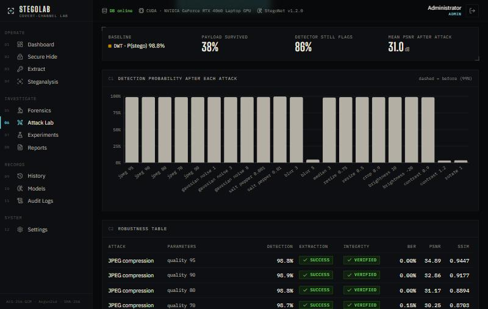<br><sub><b>Attack lab</b>: payload survival under processing</sub></td>
  </tr>
  <tr>
    <td>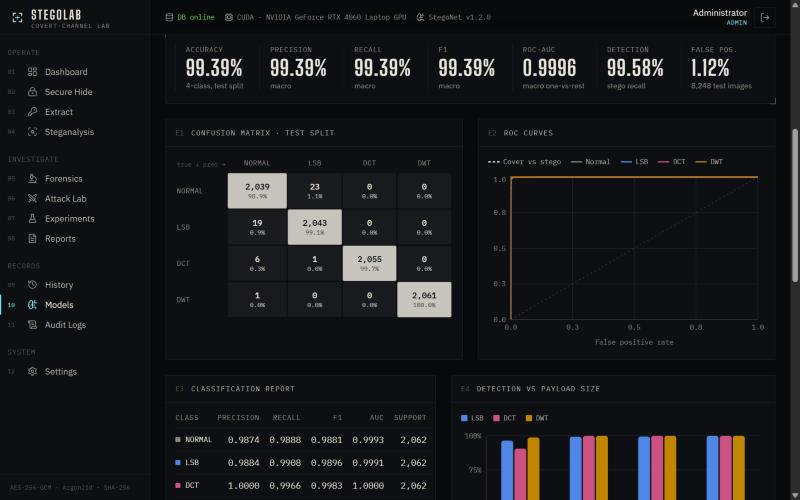<br><sub><b>Models</b>: test-set metrics, confusion matrix and ROC</sub></td>
    <td>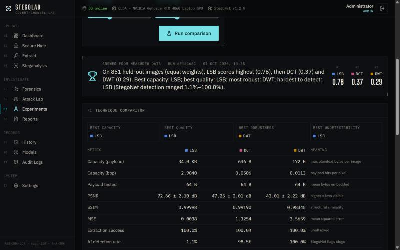<br><sub><b>Experiments</b>: LSB vs DCT vs DWT on held-out images</sub></td>
  </tr>
</table>

## Measured results

### Steganalysis models

All figures are from the held-out **test** split: 8,248 tiles from 851 source photos that were
never used for training or checkpoint selection.

<!-- RESULTS:START -->
| Model | Version | Test accuracy | Macro F1 | ROC-AUC | Stego detection | False positives |
|---|---|---|---|---|---|---|
| steganalysis-cnn | 1.0.0 | 94.73% | 0.9467 | 0.9888 | 99.47% | 18.67% |
| steganalysis-cnn | 1.1.0 | 94.56% | 0.9455 | 0.9857 | 98.19% | 15.52% |
| steganalysis-cnn | 1.2.0 | 99.39% | 0.9939 | 0.9996 | 99.58% | 1.12% |
| steganalysis-rf | 1.0.0 | 89.17% | 0.8918 | 0.9835 | 94.67% | 15.37% |
| steganalysis-rf | 1.1.0 | 93.48% | 0.9355 | 0.9920 | 94.20% | 5.67% |

All versions evaluated on the same current test split. Full comparison, including the false-positive study under benign processing: [`docs/experiments/model_comparison.md`](docs/experiments/model_comparison.md).
<!-- RESULTS:END -->

**StegoNet v1.2.0** is the active model. Version 1.0.0 flagged 99% of clean photos that only had
mild sensor noise. Two measured fixes brought that down to 2.3–4.7%: training on processed
clean covers (v1.1.0) and adding parity-aware weighted-stego inputs (v1.2.0). The full story is in
[`docs/experiments`](docs/experiments/README.md). RF v1.0.0 weights are not shipped because v1.1.0
supersedes them; its metrics are kept for comparison.

### LSB vs DCT vs DWT (same 64-byte message, 851 held-out images)

| Metric | LSB | DCT | DWT |
|---|---|---|---|
| Capacity per 256×256 tile | 34,825 B | 636 B | 172 B |
| PSNR | **72.66 dB** | 47.25 dB | 43.01 dB |
| SSIM | **1.0000** | 0.9919 | 0.9835 |
| Extraction success | 100% | 100% | 100% |
| Detected by StegoNet | **1.1%** | 98.5% | 100% |
| Survives the attack suite | 4.0% | 60.2% | **77.2%** |
| Embed / extract time | 0.3 / 0.2 ms | 11.6 / 2.2 ms | 14.0 / 2.8 ms |

**The trade-off:** LSB is the most invisible and the hardest to detect when the message is small,
but almost any processing destroys it. The transform-domain methods survive JPEG and noise, but
they leave statistical traces that StegoNet finds. At 50% of each method's capacity, all three are
detected 99.5–100% of the time. Methodology and the second experiment:
[`docs/experiments/README.md`](docs/experiments/README.md).

## Quick start

### Requirements

| | Version | Notes |
|---|---|---|
| [Python](https://www.python.org/downloads/) | **3.11 or 3.12** | 3.12 recommended. On Windows, tick *Add python.exe to PATH* |
| [Node.js](https://nodejs.org/) | **20 or newer** | includes npm |
| [Git](https://git-scm.com/) | any | |
| NVIDIA GPU | optional | Detected automatically. CPU inference works everywhere |

Disk space: about **5 GB** with CUDA PyTorch, or about **1.5 GB** with CPU-only PyTorch.

### 1 · Clone

```bash
git clone https://github.com/vedantharne24-bot/Stenography.git
cd Stenography
```

On Windows, clone to a short path such as `C:\Stenography`. PyTorch has deeply nested files that
can exceed Windows' 260-character path limit.

### 2 · Set up (once)

**Windows** (PowerShell):

```powershell
powershell -ExecutionPolicy Bypass -File setup.ps1
```

**Linux / macOS**:

```bash
./setup.sh
```

The setup script:

1. creates `backend/.venv`
2. installs PyTorch (CUDA 12.8 build if an NVIDIA GPU is found, otherwise CPU) and the backend
   dependencies
3. writes `backend/.env` with fresh random secrets and an admin password
4. creates the database (SQLite, no installation needed)
5. creates the admin account
6. registers the bundled trained models
7. imports the research results
8. installs the frontend packages

It usually takes 5–15 minutes, mostly for the PyTorch download. Add `-Cpu` (Windows) or `--cpu`
(Linux) to force CPU-only PyTorch.

### 3 · Start

**Windows**:

```powershell
powershell -ExecutionPolicy Bypass -File start.ps1
```

**Linux / macOS**:

```bash
./start.sh
```

| | URL |
|---|---|
| Web app | http://localhost:5173 |
| API health | http://127.0.0.1:8000/api/health |
| Interactive API docs | http://127.0.0.1:8000/docs |

### 4 · Sign in

The admin account is `admin@stegolab.local`. Its password was generated randomly during setup.
Find it on the `BOOTSTRAP_ADMIN_PASSWORD=` line in **`backend/.env`**. That file is git-ignored
and must never be committed.

You can also register a new account from the login page. New accounts get the USER role.

### Alternative: Docker

```bash
cp .env.example .env    # set POSTGRES_PASSWORD, SECRET_KEY, JWT_SECRET (32+ chars) and the admin bootstrap values
docker compose up --build -d
# http://localhost:8080
```

This runs PostgreSQL 17, the API and an nginx-served frontend. Details, GPU containers and HTTPS
are covered in [docs/DEPLOYMENT.md](docs/DEPLOYMENT.md).

### Optional: PostgreSQL instead of SQLite

```bash
backend/.venv/Scripts/python scripts/init_env.py --postgres     # Linux/macOS: backend/.venv/bin/python
psql -U postgres -h localhost -f scripts/setup_postgres.sql      # creates the stegolab role and database
backend/.venv/Scripts/python scripts/migrate_to_postgres.py      # migrates, copies your data, switches backend/.env
```

The first command adds PostgreSQL credentials to your existing `backend/.env`, so it is safe to
run after setup. `scripts/setup_postgres.sql` contains a password and is git-ignored.

## Using StegoLab

| Step | Page | What happens |
|---|---|---|
| 1 | **Secure Hide** | Drop a cover image, type a message or attach a file, choose LSB / DCT / DWT, then choose a password or let StegoLab generate a key. The payload is encrypted, framed and embedded. You get the stego PNG, quality metrics and a capacity report. |
| 2 | **Extract** | Upload the stego image with the password or key. The method is auto-detected, the payload is decrypted, and integrity is verified with GCM and SHA-256. |
| 3 | **Steganalysis** | Upload any image. StegoNet, the Random Forest and the anomaly model give a verdict, the probable technique, a 0–100 risk score and Grad-CAM heat maps. |
| 4 | **Forensics** *(analyst)* | Inspect the LSB plane and noise residual, LSB statistics, χ² / SPA tests, DCT and wavelet statistics, metadata and hashes. |
| 5 | **Attack Lab** *(analyst)* | Apply JPEG, noise, blur, resize, crop, rotation and more to a stego image. See whether the payload survives and whether the detector still sees it. |
| 6 | **Experiments** *(analyst)* | Compare LSB, DCT and DWT on held-out images with your own weights for capacity, quality, robustness and undetectability. |
| 7 | **Reports** *(analyst)* | Generate a PDF security report for any analysis. |
| | **History · Models · Audit Logs · Settings** | Your past operations, model versions and activation (admin), the audit trail (admin), and user and role management (admin). |

### Roles

| Role | Permissions |
|---|---|
| **USER** | encrypt, embed, extract and analyse images; view and delete own history |
| **ANALYST** | everything a USER can do, plus forensics, attack lab, experiments, reports, model evaluation and the global dashboard |
| **ADMIN** | everything an ANALYST can do, plus user and role management, audit logs, model activation, system settings and all history |

Promote a user from **Settings**, or from the command line:

```bash
cd backend
.venv/Scripts/python -m app.cli set-role someone@example.com ANALYST     # Linux/macOS: .venv/bin/python
```

## How it works

```
 SECRET ──► AES-256-GCM ──► frame: header + ciphertext + SHA-256 ──► Reed-Solomon ──► LSB / DCT / DWT ──► stego PNG
            (Argon2id key)                                                                                    │
 REPORT ◄── risk score ◄── Grad-CAM ◄── StegoNet CNN + Random Forest + anomaly model ◄── steganalysis ◄────────┘
```

**Encryption.** The payload (text or file) is sealed with AES-256-GCM. The key comes from your
password through Argon2id, or is a random 256-bit key shown once. The envelope header (version,
KDF parameters, salt, nonce) is authenticated as associated data. A SHA-256 of the plaintext is
checked again after decryption.

**Framing.** The envelope and its SHA-256 are prefixed with a 24-byte header that carries a magic
value, the algorithm, the ECC strength and the length. The header is protected by Reed-Solomon
codes. DCT and DWT bodies are also RS-coded, so a few flipped bits are corrected rather than fatal.
Bits are spread uniformly over the image with a public Weyl-sequence permutation.

**Embedding.**

- *LSB* writes 3 bits per pixel into the RGB least-significant bits. It is high capacity and
  invisible, but fragile.
- *DCT* uses quantisation-index modulation on five mid-frequency coefficients of each 8×8 luma
  block (step 24).
- *DWT* applies QIM to the level-3 Haar LH/HL sub-bands (step 40).

DCT and DWT run a correction loop that re-embeds until every bit has a safety margin after
rounding to 8-bit pixels.

**Detection.**

- *StegoNet* has three branches over 256×256 tiles: SRM high-pass residuals plus weighted-stego
  parity channels, soft histograms of block-DCT coefficients, and soft histograms of Haar wavelet
  coefficients. The branches are fused into a 4-way classifier: clean, LSB, DCT or DWT.
- The *Random Forest* uses 99 handcrafted features: χ², sample-pair analysis, SPAM, and DCT/DWT
  periodicity.
- A *Mahalanobis* anomaly model is fitted on clean covers.
- The risk score is a weighted blend (CNN 0.55, RF 0.25, anomaly 0.20). It is raised to a floor
  when a valid StegoLab frame is decoded.

**Training data.** The dataset has 55,248 tiles from 5,706 photos (800 DIV2K + 4,906 COCO). Tiles
are split *by source photo* (70/15/15), so no photo appears in two splits. The covers include
JPEG-recompressed, noisy, blurred and resampled versions, so normal processing is not mistaken for
steganography.

The full derivations are in [docs/TECHNICAL.md](docs/TECHNICAL.md).

## Architecture

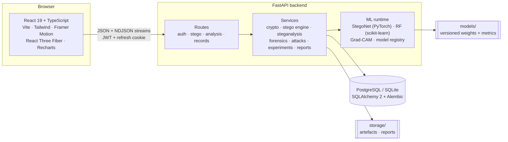

Long operations stream progress as NDJSON, so the operation log in the UI shows each step as it
happens on the server.

```
Stenography/
├── backend/
│   ├── app/
│   │   ├── api/            routes + dependencies (auth, RBAC)
│   │   ├── core/           config, security, permissions, rate limiting, errors, streaming
│   │   ├── db/             SQLAlchemy models and session
│   │   ├── ml/             StegoNet, features, inference + Grad-CAM, evaluation, registry
│   │   ├── services/       crypto, stego/{lsb,dct,dwt,framing}, steganalysis, forensics, attacks, experiments, reports …
│   │   └── cli.py          bootstrap-admin · set-role · sync-models · import-experiments · purge-expired
│   ├── alembic/            database migrations
│   ├── pipeline/           dataset generation, training, evaluation, experiments
│   ├── models/             trained models (StegoNet 1.0.0–1.2.0, RF 1.1.0) with metrics and plots
│   ├── demo_carriers/      44 freely licensed held-out images for the live demo and experiments
│   └── tests/              pytest suite
├── frontend/
│   └── src/                pages, components, landing + 3D scene, API client
├── data/dataset/stats.json dataset statistics (the 11 GB tile arrays are regenerated, not stored)
├── docs/                   technical, security, API, deployment, experiments, screenshots
├── scripts/                env generation, PostgreSQL migration, demo-carrier builder
├── setup.ps1 / setup.sh    one-time setup
├── start.ps1 / start.sh    start API + web app
└── docker-compose.yml      PostgreSQL + API + nginx
```

## Reproducing the research

The trained models are included, so this step is optional. To regenerate everything from raw data:

1. Download [DIV2K](https://data.vision.ee.ethz.ch/cvl/DIV2K/) `DIV2K_train_HR.zip` and
   [COCO 2017](https://cocodataset.org/#download) `val2017.zip`.
2. Extract both into `data/covers/`.
3. Run the pipeline:

```bash
cd backend
python -m pipeline.generate_dataset            # ~4 min, ~11 GB: 55,248 tiles, leakage-checked splits
python -m pipeline.train_model --model all     # Random Forest (~5 min CPU) + StegoNet (~70 min on an RTX 4060)
python -m pipeline.evaluate_model              # independent re-evaluation of the saved weights
python -m pipeline.compare_models              # all versions on one test split; refreshes the table above
python -m pipeline.detector_robustness         # false positives under benign processing
python -m pipeline.run_experiments             # LSB vs DCT vs DWT on every held-out image
```

New model versions appear automatically and can be activated from the **Models** page.

## Testing

```bash
cd backend && .venv/Scripts/python -m pytest       # 93 tests: auth, RBAC, crypto, stego, ML, risk, attacks, reports, privacy
cd frontend && npm test                            # 11 tests: streaming client, token refresh, components, accessibility
cd frontend && npm run typecheck && npm run build
```

(On Linux/macOS use `.venv/bin/python`.)

## Configuration

`backend/.env` is created by the setup script. Every option is documented in
[`.env.example`](.env.example).

| Variable | Purpose |
|---|---|
| `DATABASE_URL` | PostgreSQL URL; SQLite at `backend/storage/stegolab.db` when unset |
| `SECRET_KEY`, `JWT_SECRET` | 32+ random characters each (generated for you) |
| `DEVICE` | `auto`, `cuda` or `cpu` for model inference |
| `MAX_UPLOAD_SIZE`, `MAX_IMAGE_PIXELS` | upload and decompression-bomb limits |
| `TEMP_RETENTION_HOURS` | how long temporary artefacts are kept |
| `KDF_TIME_COST`, `KDF_MEMORY_KIB`, `KDF_PARALLELISM` | Argon2id cost for payload passwords |
| `RATE_LIMIT_*` | per-IP limits for auth and heavy endpoints |
| `COOKIE_SECURE`, `CORS_ORIGINS` | set for HTTPS deployments |
| `BOOTSTRAP_ADMIN_EMAIL`, `BOOTSTRAP_ADMIN_PASSWORD` | first administrator |

## Troubleshooting

| Problem | Fix |
|---|---|
| `Python 3.11+ is required` | Install Python 3.12 and tick *Add python.exe to PATH*, then open a new terminal |
| pip fails with *path too long* (Windows) | Clone to a short path such as `C:\Stenography`, or [enable long paths](https://pip.pypa.io/warnings/enable-long-paths) |
| `running scripts is disabled on this system` | Use the exact command shown, which includes `-ExecutionPolicy Bypass` |
| Header shows **CPU** although you have a GPU | Re-run setup with an up-to-date NVIDIA driver installed (`nvidia-smi` must work). CPU inference is fully supported, just slower |
| Port 8000 or 5173 is busy | Stop the other program, or start manually: `uvicorn app.main:app --port 8001` and `VITE_API_PROXY=http://127.0.0.1:8001 npm run dev` |
| Forgot the admin password | The initial password is the `BOOTSTRAP_ADMIN_PASSWORD` line in `backend/.env` |
| `429 Too Many Requests` | The rate limiter is working. Wait about a minute, or raise `RATE_LIMIT_HEAVY` in `backend/.env` for local use |

## Limitations

- **Tiny payloads are hard to detect.** A short message in a large image changes too few pixels
  for any statistical detector. StegoLab still recognises its *own* frame format, and the UI says
  when that is the only evidence.
- **Cover-source mismatch.** Detectors can misfire on processing they never saw during training.
  The studied cases (JPEG, noise, blur, resampling) are covered and measured. Heavy filters,
  denoising or screenshots may still raise false positives, so re-run
  `pipeline.compare_models` on new data before relying on the detector in a new setting.
- **Kerckhoffs's principle.** The embedding positions are public. Confidentiality rests on
  AES-256-GCM, not on hiding where the bits are.
- **Docker was not run on the development machine.** The Docker files are provided and reviewed,
  but the scripted local setup is the tested path.

## Documentation

| Document | Contents |
|---|---|
| [docs/TECHNICAL.md](docs/TECHNICAL.md) | Cryptography, framing, LSB/DCT/DWT, metrics, dataset, CNN, training, Grad-CAM, risk scoring, attacks, research method |
| [docs/SECURITY.md](docs/SECURITY.md) | Threat model, authentication, RBAC, validation, secrets, audit, privacy and retention |
| [docs/API.md](docs/API.md) | Endpoints, streaming protocol, errors, examples |
| [docs/DEPLOYMENT.md](docs/DEPLOYMENT.md) | Development, PostgreSQL, Docker Compose, GPU, HTTPS |
| [docs/experiments/](docs/experiments/README.md) | QIM parameter sweep, model comparison, false-positive study, technique comparison |

## Credits

- **Training data:** [DIV2K](https://data.vision.ee.ethz.ch/cvl/DIV2K/) (Agustsson & Timofte,
  NTIRE 2017) and [COCO 2017](https://cocodataset.org/) (Lin et al., 2014). The images are not
  redistributed here.
- **Demo images:** public-domain and CC0 photographs distributed with
  [scikit-image](https://scikit-image.org/). See
  [backend/demo_carriers/SOURCES.md](backend/demo_carriers/SOURCES.md) for authors and terms.
- **Built with:** FastAPI, SQLAlchemy, Alembic, PyTorch, scikit-learn, OpenCV, PyWavelets,
  `cryptography`, argon2-cffi, reedsolo, ReportLab, React, Vite, Tailwind CSS, Framer Motion,
  Three.js / React Three Fiber, Recharts.

## Author

**Vedant Harne** · [@vedantharne24-bot](https://github.com/vedantharne24-bot)
